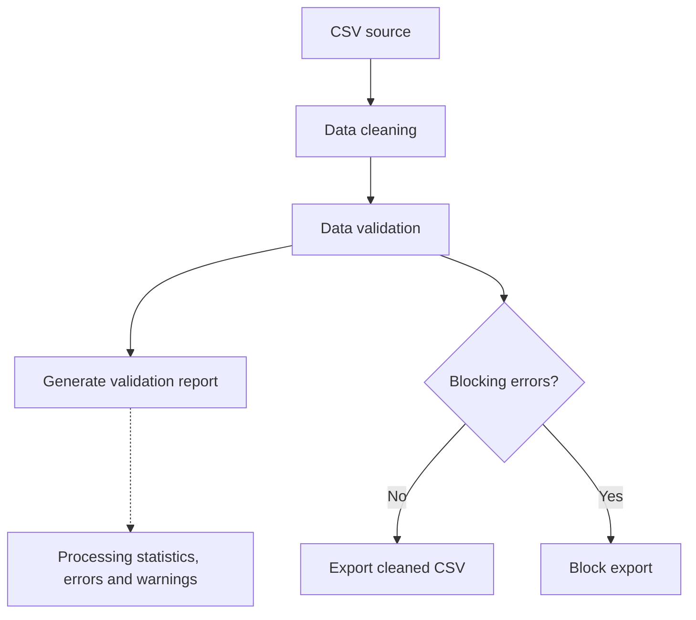

# CSV Automation Toolkit

A Python tool for cleaning, validating, and processing CSV files with automated data quality checks and validation reports.

## Overview

Customer data stored in CSV files can contain duplicate records, missing information, unnecessary spaces, or invalid email addresses. These issues can reduce data quality and cause problems in reports or downstream systems.

CSV Automation Toolkit is a Python tool that automates essential data preparation tasks before customer data is exported for further use.

It:
- Removes exact duplicate records.
- Trims unnecessary spaces and standardizes empty values.
- Validates required fields and email address formats.
- Generates a structured report showing processing statistics, errors, and warnings.
- Blocks the export of cleaned data when blocking validation errors are detected.

The goal is to make customer data more consistent, easier to inspect, and safer to use in subsequent workflows.


## Workflow




## Features

- **Data cleaning:** trims whitespace from column names and text values.
- **Missing-value handling:** converts blank or whitespace-only strings into missing values.
- **Duplicate removal:** removes exact duplicate rows.
- **Data validation:** checks required columns and detects missing or malformed email addresses.
- **Warnings:** identifies missing city values without blocking the export.
- **Safe export behavior:** blocks exports when validation errors are present.
- **Stale-output protection:** removes a previously generated cleaned file when the current input cannot be loaded or fails validation.
- **CSV reporting:** records processing statistics, blocking errors, warnings, and export status.
- **Automated testing:** includes unit tests and integration tests.

## Project Structure

```text
CSV Automation Toolkit/
├── data/
│   ├── raw/
│   │   └── customers.csv
│   └── processed/
├── outputs/
│   └── validation_report.csv
├── src/
│   ├── cleaner.py
│   ├── validator.py
│   ├── report.py
│   └── main.py
├── tests/
│   ├── test_cleaner.py
│   ├── test_validator.py
│   └── test_main.py
├── .gitignore
├── README.md
└── requirements.txt
```

## Requirements

- Python 3
- pandas 3.0.5

The project has been tested with Python 3.14.7 and pandas 3.0.5.

## Installation

Clone the repository or download the project files.

Create and activate a virtual environment:

```bash
python -m venv .venv
```

On Windows PowerShell:

```powershell
.\.venv\Scripts\Activate.ps1
```

Install the dependencies:

```bash
python -m pip install -r requirements.txt
```

## Input Data

The example dataset is located at:

`data/raw/customers.csv`

The expected columns are:

| Column | Purpose |
|---|---|
| `Customer_ID` | Customer identifier |
| `Name` | Customer name |
| `Email` | Customer email address |
| `City` | Customer city |

The validator requires all four columns. Missing customer IDs, names, or emails are blocking errors. Malformed email addresses also block export. A missing city generates a warning.

## Usage

Run the pipeline from the project root:

```bash
python -m src.main
```

The program will:

1. Load the source CSV file.
2. Clean the data.
3. Validate the cleaned dataset.
4. Export the cleaned file only when validation succeeds.
5. Generate a validation report.

### Output Files

**Processed dataset**

`data/processed/customers_cleaned.csv`

Created only when validation succeeds.

**Validation report**

`outputs/validation_report.csv`

Contains a summary row, error records, warning records, row counts, duplicate-removal statistics, and export status.

The report is also generated when the source file cannot be loaded, provided the report can be written successfully.

## Example Validation Result

The included sample dataset contains six rows, including one exact duplicate, one missing email, and one missing city.

The expected processing summary is:

| Metric | Result |
|---|---:|
| Original rows | 6 |
| Cleaned rows | 5 |
| Duplicates removed | 1 |
| Blocking errors | 1 |
| Warnings | 1 |
| Export status | BLOCKED |

Because the sample contains a missing email, the cleaned dataset is not exported. The validation report records the blocking error and the non-blocking warning.

## Running Tests

Run the automated test suite from the project root:

```bash
python -m unittest discover -s tests -v
```

The current test suite contains 16 tests covering data cleaning, validation, successful exports, blocked exports, stale-output removal, and source-file loading failures.

## Current Limitations

- The tool currently targets a predefined CSV schema.
- Email validation uses a practical format check, not verification that an address exists.
- Validation row numbers are based on the cleaned dataset and may not correspond to the original source-file row numbers after duplicate removal.
- The tool processes one configured input file per run.
- A validation report may contain data-quality details that should be reviewed before sharing externally.

## Future Improvements

Potential extensions include:

- Configurable schemas and required columns.
- Original-source row tracking.
- Additional data-quality rules.
- Command-line arguments for input and output paths.
- More detailed logging and summary statistics.
- Support for processing multiple CSV files.

## License

This project is licensed under the MIT License. See the [LICENSE](LICENSE) file for the full license text.

Copyright (c) 2026 Alan Ngang.

## Author

**Alan Ngang**

- GitHub: [@chrono-byte238](https://github.com/chrono-byte238)
- LinkedIn: [Alan Ngang](https://cm.linkedin.com/in/alan-ngang-5295a338a)

This project was developed as part of my Python learning journey, with a focus on data cleaning, validation, automation, and software testing.

**Built with Python and pandas.**
